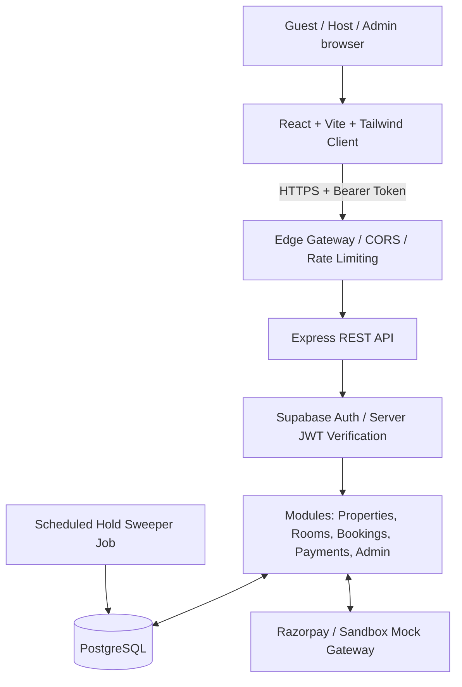

# StayNest Architecture & Design Specification

## 1. Overview
StayNest is a full-stack accommodation booking platform for hotels, lounges, and guest houses. Designed as a modular monolith, it balances security, data integrity, and low infrastructure overhead.

## 2. Key Architectural Tenets
1. **Zero Client Trust**: All pricing computations, room inventory checks, role authorizations, and payment verifications happen strictly on the server.
2. **Concurrency-Safe Inventory Allocation**:
   - Availability is calculated against both `CONFIRMED` bookings and active `PENDING_PAYMENT` holds (`expiresAt > now`).
   - Overbooking is prevented inside an atomic PostgreSQL interactive transaction.
3. **Idempotent Webhooks**:
   - Webhook events are cryptographically verified and recorded in `payment_webhook_events` with unique `(provider, provider_event_id)` constraints.
4. **Flexible Authentication**:
   - Local JWT tokens are verified on the server.
   - User profiles in PostgreSQL maintain server-authoritative roles (`GUEST`, `HOST`, `ADMIN`).
5. **Decoupled Integrations**:
   - Small provider interfaces (`IPaymentProvider`) isolate external gateway specifics from core reservation logic.
